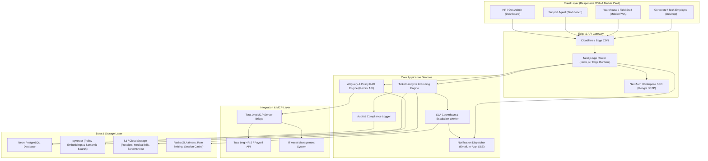
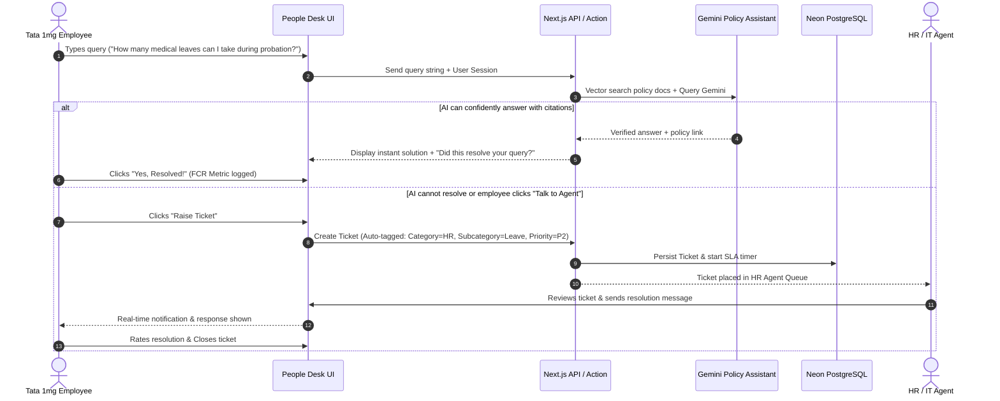

# System Architecture & Technical Specifications
## Project: Tata 1mg People Desk

---

### 1. High-Level Architecture Overview

Tata 1mg People Desk is built on a modern, high-performance, event-driven fullstack architecture designed for enterprise scalability, fast response times, and robust AI integrations.

---

### 2. Core Architectural Components

#### 2.1 Frontend & Application Layer
- **Framework**: Next.js 14/15 with React Server Components (RSC) and Server Actions.
- **Styling & UI**: Tailwind CSS + shadcn/ui + Radix UI primitives.
- **State Management & Data Fetching**: TanStack React Query v5 for client state + Server Components for data hydration.
- **Real-Time Communication**: Server-Sent Events (SSE) or WebSockets for live ticket updates, agent-employee chat, and SLA notifications.

#### 2.2 AI & Knowledge Engine (RAG)
- **Model**: Google Gemini 1.5 Pro / Flash via official Gemini SDK.
- **Embeddings**: `text-embedding-004` stored in PostgreSQL with the `pgvector` extension.
- **Knowledge Base Source**: Tata 1mg employee handbooks, leave policies, health insurance coverage guides, diagnostic protocol documents, travel reimbursement guidelines.
- **Fallback Logic**: When AI confidence is below threshold ($< 80\%$) or requires employee-specific manual action, the query seamlessly converts into a structured support ticket.

#### 2.3 Model Context Protocol (MCP) Integration
- Implements the MCP protocol to provide standard tools to the AI assistant:
  - `mcp_tata1mg_get_employee_leave_balance`
  - `mcp_tata1mg_get_payslip_status`
  - `mcp_tata1mg_get_assigned_assets`
  - `mcp_tata1mg_check_claim_reimbursement`
- Ensures sandboxed, authenticated execution with principle of least privilege.

#### 2.4 Data & Storage Architecture
- **Primary Database**: Neon PostgreSQL (Serverless PostgreSQL with connection pooling and automated branch management for preview environments).
- **Blob Storage**: Secure cloud storage (AWS S3 or Cloudflare R2) with pre-signed URLs for query attachments (e.g., medical claims, hardware issue screenshots).
- **Message Broker / Async Jobs**: Redis + BullMQ for handling background SLA timers, notification fan-out, and auto-escalations.

---

### 3. Data Flow Diagram: Query Submission to Resolution

---

### 4. Scalability, Resilience & High Availability
1. **Stateless API Services**: Serverless/Edge compute enables rapid horizontal scaling during peak HR seasons (performance appraisal periods, tax declaration season, policy rollouts).
2. **Database Connection Pooling**: Neon's built-in PgBouncer pooling prevents socket exhaustion under heavy load.
3. **Graceful Degradation**: If the AI model or external HRIS is unreachable, the ticket creation flow operates in fallback mode without interrupting employee submissions.
4. **Data Isolation**: Departmental data is logically partitioned with strict Row-Level Security (RLS) policies.

