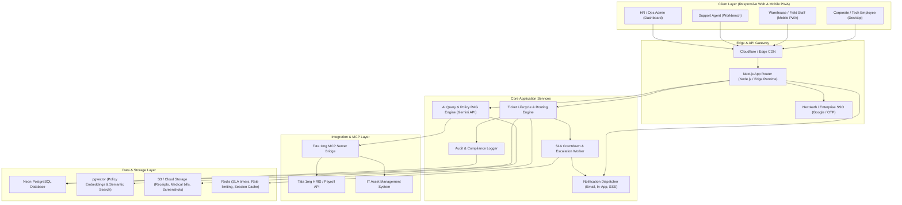
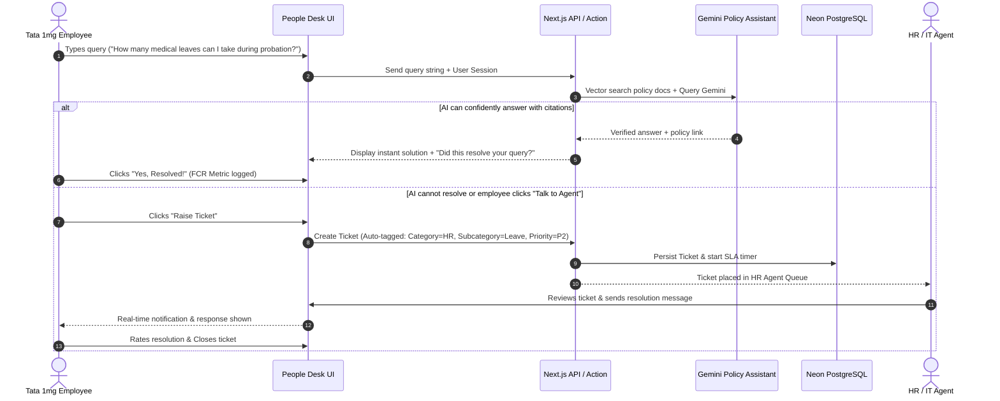

# System Architecture & Technical Specifications
## Project: Tata 1mg People Desk

---

### 1. High-Level Architecture Overview

Tata 1mg People Desk is built on a modern, high-performance, event-driven fullstack architecture designed for enterprise scalability, fast response times, and robust AI integrations.

---

### 2. Core Architectural Components

#### 2.1 Backend & Application Layer
- **Framework**: Python 3.10+ with FastAPI, Starlette, and Uvicorn.
- **API Architecture**: Modular RESTful APIs with OpenAPI / Swagger documentation (`/docs`).
- **Database Connectivity**: Dual-mode engine: Primary ultra-low latency Neon HTTPS SQL API (port 443, firewall-proof) with automatic fallback to psycopg2 TCP (port 5432).
- **Static Asset Serving**: High-speed GZip compression middleware (`minimum_size=1000`) serving frontend assets, admin console, and agent workbench.

#### 2.2 Frontend & Presentation Layer
- **Design System**: Custom Tata 1mg Enterprise Design System in semantic HTML5 and responsive modern CSS3.
- **Client Architecture**: Modular Vanilla ES6 JavaScript controllers:
  - `login.js`: Multi-step email detection, app password validation, and onboarding.
  - `agent.js`: Multi-pane Agent Triage Cockpit, live IMAP mailbox sync, and AI copilot.
  - `admin.js`: Universal administrative control, dynamic department routing, and staff roster.
  - `case-details.js`: 360° Case Dossier, Darwinbox HRMS integration, and forensic audit trail.

#### 2.3 AI & Machine Learning Classification Engine
- **Architecture**: 2-Stage automated NLP classification pipeline:
  - **Stage 1 (Weighted Keyword Scoring)**: Multi-word strong phrases (+3.2 Subject, +2.2 Body) and weak keywords (+1.5 Subject, +0.8 Body) evaluated dynamically across all active departments.
  - **Stage 2 (Intent Classifier)**: Scikit-learn `LinearSVC` with `TfidfVectorizer` (sublinear TF, n-gram range 1-2).
- **Training & Hot-Reloading**: In-memory hot-reload cache with serialized `.pkl` model weights exported to `backend/app/classification/models/`.

#### 2.4 Omni-Channel Ingestion & Notification Engine
- **Inbound Mailbox Ingestion**: Secure IMAP (SSL Port 993) supporting Google Workspace and Zoho Mail with spam filtering, thread grouping, and entity extraction.
- **Outbound Email Dispatch**: RFC-2822 compliant MIME email generator with anti-spam headers and resilient SMTP delivery (TLS Port 587 / SSL Port 465 fallback).
- **Audit & Compliance**: Immutable JSONB event logging for all status transitions, reassignments, SLA overrides, and communication dispatches.

---

### 3. Data Flow Diagram: Query Submission to Resolution

---

### 4. Scalability, Resilience & High Availability
1. **Stateless API Services**: Serverless/Edge compute enables rapid horizontal scaling during peak HR seasons (performance appraisal periods, tax declaration season, policy rollouts).
2. **Database Connection Pooling**: Neon's built-in PgBouncer pooling prevents socket exhaustion under heavy load.
3. **Graceful Degradation**: If the AI model or external HRIS is unreachable, the ticket creation flow operates in fallback mode without interrupting employee submissions.
4. **Data Isolation**: Departmental data is logically partitioned with strict Row-Level Security (RLS) policies.

