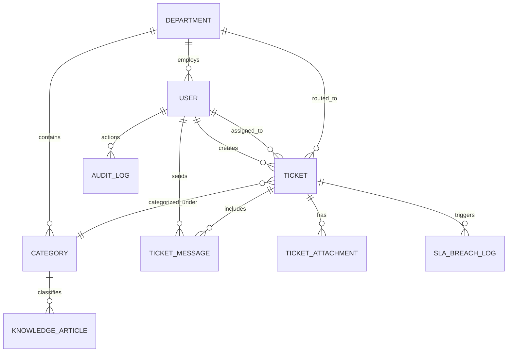

# Database Schema & Data Models
## Project: Tata 1mg People Desk (PostgreSQL / Neon)

---

### 1. Entity-Relationship (ER) Diagram



---

### 2. SQL Schema Definition (PostgreSQL 15+ / Neon)

```sql
-- Enable necessary extensions
CREATE EXTENSION IF NOT EXISTS "uuid-ossp";
CREATE EXTENSION IF NOT EXISTS "vector"; -- for RAG embeddings

-- ENUMS
CREATE TYPE user_role AS ENUM (
    'EMPLOYEE', 
    'FIELD_STAFF', 
    'AGENT', 
    'DEPT_LEAD', 
    'SUPER_ADMIN'
);

CREATE TYPE ticket_priority AS ENUM (
    'P0_CRITICAL', 
    'P1_HIGH', 
    'P2_MEDIUM', 
    'P3_LOW'
);

CREATE TYPE ticket_status AS ENUM (
    'OPEN', 
    'AI_HANDLED', 
    'ASSIGNED', 
    'IN_PROGRESS', 
    'WAITING_ON_EMPLOYEE', 
    'RESOLVED', 
    'CLOSED', 
    'ESCALATED'
);

CREATE TYPE message_type AS ENUM (
    'PUBLIC_REPLY', 
    'INTERNAL_NOTE', 
    'SYSTEM_ACTIVITY', 
    'AI_RESPONSE'
);

-- 1. DEPARTMENTS
CREATE TABLE departments (
    id UUID PRIMARY KEY DEFAULT uuid_generate_v4(),
    name VARCHAR(100) NOT NULL UNIQUE,
    code VARCHAR(20) NOT NULL UNIQUE, -- e.g., 'HR', 'IT', 'PAYROLL', 'LOGISTICS', 'DIAGNOSTICS'
    description TEXT,
    created_at TIMESTAMPTZ DEFAULT NOW(),
    updated_at TIMESTAMPTZ DEFAULT NOW()
);

-- 2. USERS (Tata 1mg Employees & Agents)
CREATE TABLE users (
    id UUID PRIMARY KEY DEFAULT uuid_generate_v4(),
    emp_id VARCHAR(50) NOT NULL UNIQUE, -- e.g. '1MG-8492'
    full_name VARCHAR(150) NOT NULL,
    email VARCHAR(255) NOT NULL UNIQUE,
    phone VARCHAR(20),
    role user_role DEFAULT 'EMPLOYEE',
    department_id UUID REFERENCES departments(id) ON DELETE SET NULL,
    work_location VARCHAR(100), -- 'Gurgaon HQ', 'Okhla Warehouse', 'Bangalore Lab', etc.
    designation VARCHAR(100),
    is_active BOOLEAN DEFAULT TRUE,
    created_at TIMESTAMPTZ DEFAULT NOW(),
    updated_at TIMESTAMPTZ DEFAULT NOW()
);

-- 3. CATEGORIES & SUBCATEGORIES
CREATE TABLE categories (
    id UUID PRIMARY KEY DEFAULT uuid_generate_v4(),
    department_id UUID NOT NULL REFERENCES departments(id) ON DELETE CASCADE,
    name VARCHAR(100) NOT NULL,
    slug VARCHAR(100) NOT NULL UNIQUE,
    default_priority ticket_priority DEFAULT 'P2_MEDIUM',
    sla_resolution_hours INT DEFAULT 24,
    is_active BOOLEAN DEFAULT TRUE,
    created_at TIMESTAMPTZ DEFAULT NOW()
);

-- 4. TICKETS
CREATE TABLE tickets (
    id UUID PRIMARY KEY DEFAULT uuid_generate_v4(),
    ticket_number VARCHAR(30) NOT NULL UNIQUE, -- e.g. 'TKT-2026-001082'
    title VARCHAR(255) NOT NULL,
    description TEXT NOT NULL,
    status ticket_status DEFAULT 'OPEN',
    priority ticket_priority DEFAULT 'P2_MEDIUM',
    department_id UUID NOT NULL REFERENCES departments(id),
    category_id UUID NOT NULL REFERENCES categories(id),
    requester_id UUID NOT NULL REFERENCES users(id),
    assignee_id UUID REFERENCES users(id),
    sla_due_at TIMESTAMPTZ NOT NULL,
    first_responded_at TIMESTAMPTZ,
    resolved_at TIMESTAMPTZ,
    closed_at TIMESTAMPTZ,
    is_escalated BOOLEAN DEFAULT FALSE,
    csat_rating INT CHECK (csat_rating BETWEEN 1 AND 5),
    csat_feedback TEXT,
    created_at TIMESTAMPTZ DEFAULT NOW(),
    updated_at TIMESTAMPTZ DEFAULT NOW()
);

-- 5. TICKET MESSAGES & THREADS
CREATE TABLE ticket_messages (
    id UUID PRIMARY KEY DEFAULT uuid_generate_v4(),
    ticket_id UUID NOT NULL REFERENCES tickets(id) ON DELETE CASCADE,
    sender_id UUID REFERENCES users(id) ON DELETE SET NULL,
    message_type message_type DEFAULT 'PUBLIC_REPLY',
    content TEXT NOT NULL,
    created_at TIMESTAMPTZ DEFAULT NOW()
);

-- 6. TICKET ATTACHMENTS
CREATE TABLE ticket_attachments (
    id UUID PRIMARY KEY DEFAULT uuid_generate_v4(),
    ticket_id UUID NOT NULL REFERENCES tickets(id) ON DELETE CASCADE,
    message_id UUID REFERENCES ticket_messages(id) ON DELETE CASCADE,
    file_name VARCHAR(255) NOT NULL,
    file_url TEXT NOT NULL,
    file_size_bytes BIGINT NOT NULL,
    mime_type VARCHAR(100) NOT NULL,
    created_at TIMESTAMPTZ DEFAULT NOW()
);

-- 7. KNOWLEDGE BASE ARTICLES & VECTOR STORE
CREATE TABLE knowledge_articles (
    id UUID PRIMARY KEY DEFAULT uuid_generate_v4(),
    department_id UUID REFERENCES departments(id),
    category_id UUID REFERENCES categories(id),
    title VARCHAR(255) NOT NULL,
    slug VARCHAR(255) NOT NULL UNIQUE,
    content_markdown TEXT NOT NULL,
    tags TEXT[],
    embedding vector(768), -- Google Gemini text-embedding-004 dimensionality
    view_count INT DEFAULT 0,
    helpful_yes INT DEFAULT 0,
    helpful_no INT DEFAULT 0,
    is_published BOOLEAN DEFAULT TRUE,
    created_at TIMESTAMPTZ DEFAULT NOW(),
    updated_at TIMESTAMPTZ DEFAULT NOW()
);

-- 8. AUDIT LOGS (Compliance & Security)
CREATE TABLE audit_logs (
    id UUID PRIMARY KEY DEFAULT uuid_generate_v4(),
    user_id UUID REFERENCES users(id) ON DELETE SET NULL,
    action VARCHAR(100) NOT NULL, -- e.g. 'TICKET_STATUS_UPDATED', 'SLA_BREACH_NOTIFIED'
    entity_type VARCHAR(50) NOT NULL, -- 'TICKET', 'USER', 'POLICY'
    entity_id UUID NOT NULL,
    metadata JSONB,
    ip_address INET,
    created_at TIMESTAMPTZ DEFAULT NOW()
);
```

---

### 3. Recommended Indexes for Query Performance

```sql
-- Fast query lookup for employee dashboard
CREATE INDEX idx_tickets_requester ON tickets (requester_id, status);

-- Fast queue filtering for support agents
CREATE INDEX idx_tickets_assignee_status ON tickets (assignee_id, status);
CREATE INDEX idx_tickets_dept_priority ON tickets (department_id, priority, status);

-- Fast SLA breach detection queries
CREATE INDEX idx_tickets_sla_monitoring ON tickets (status, sla_due_at) 
WHERE status NOT IN ('RESOLVED', 'CLOSED');

-- Vector search indexing for semantic policy retrieval (HNSW or IVFFlat)
CREATE INDEX idx_knowledge_embedding ON knowledge_articles 
USING hnsw (embedding vector_cosine_ops);
```

