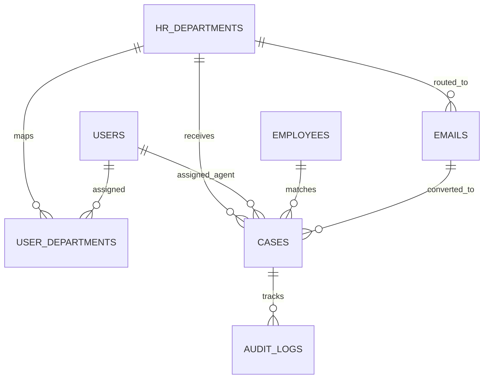

# Database Schema & Data Models
## Project: Tata 1mg People Desk (PostgreSQL / Neon)

---

### 1. Entity-Relationship (ER) Diagram



---

### 2. SQL Schema Definition (PostgreSQL 15+ / Neon Database)

```sql
-- 1. USERS TABLE (System Administrators & Support Agents)
CREATE TABLE users (
    id SERIAL PRIMARY KEY,
    email VARCHAR(255) UNIQUE NOT NULL,
    name VARCHAR(150) NOT NULL,
    role VARCHAR(50) NOT NULL DEFAULT 'HR_AGENT', -- 'ADMIN', 'HR_AGENT'
    password_hash VARCHAR(255),                  -- NULL until first-time password setup
    is_dept_head BOOLEAN DEFAULT FALSE,
    department_id INT REFERENCES hr_departments(id),
    designation VARCHAR(150),
    status VARCHAR(20) DEFAULT 'ACTIVE',          -- 'ACTIVE', 'INACTIVE'
    mail_app_password VARCHAR(255),
    mail_configured BOOLEAN DEFAULT FALSE,
    mail_last_synced_at TIMESTAMPTZ,
    created_at TIMESTAMPTZ DEFAULT NOW(),
    updated_at TIMESTAMPTZ DEFAULT NOW()
);

-- 2. HR DEPARTMENTS TABLE (Routing Desks & AI Intent Profiles)
CREATE TABLE hr_departments (
    id SERIAL PRIMARY KEY,
    dept_code VARCHAR(50) UNIQUE NOT NULL,       -- e.g. 'DEPT-ATTENDANCE', 'DEPT-PAYROLL'
    team_name VARCHAR(100) NOT NULL,
    dept_gmail VARCHAR(255) NOT NULL,
    sla_hours INT DEFAULT 24,
    default_priority VARCHAR(20) DEFAULT 'MEDIUM',
    description TEXT,
    category_code VARCHAR(50),
    color_accent VARCHAR(20) DEFAULT '#FF6F61',
    strong_keywords JSONB DEFAULT '[]'::jsonb,
    weak_keywords JSONB DEFAULT '[]'::jsonb,
    intents JSONB DEFAULT '[]'::jsonb,
    ai_model_status VARCHAR(20) DEFAULT 'UNTRAINED',
    model_accuracy NUMERIC(5,2) DEFAULT 0.0,
    trained_at TIMESTAMPTZ,
    dept_app_password VARCHAR(255),
    imap_host VARCHAR(255),
    imap_port INT DEFAULT 993,
    mail_sync_status VARCHAR(50) DEFAULT 'NOT_CONFIGURED',
    mail_last_synced_at TIMESTAMPTZ,
    created_at TIMESTAMPTZ DEFAULT NOW(),
    updated_at TIMESTAMPTZ DEFAULT NOW()
);

-- 3. USER DEPARTMENTS (Multi-department assignment for Agents)
CREATE TABLE user_departments (
    id SERIAL PRIMARY KEY,
    user_id INT NOT NULL REFERENCES users(id) ON DELETE CASCADE,
    department_id INT NOT NULL REFERENCES hr_departments(id) ON DELETE CASCADE,
    created_at TIMESTAMPTZ DEFAULT NOW(),
    UNIQUE(user_id, department_id)
);

-- 4. CASE SEQUENCES TABLE (Collision-Free Atomic 5-Digit Sequence Generator)
CREATE TABLE case_sequences (
    prefix VARCHAR(20) PRIMARY KEY DEFAULT '1MG',
    last_number BIGINT DEFAULT 0,
    updated_at TIMESTAMPTZ DEFAULT NOW()
);

-- 5. CASES TABLE (Core Employee Query Lifecycle)
CREATE TABLE cases (
    id SERIAL PRIMARY KEY,
    case_number VARCHAR(50) UNIQUE NOT NULL,      -- e.g. '1MG00001'
    employee_email VARCHAR(255) NOT NULL,
    employee_name VARCHAR(150),
    title VARCHAR(255) NOT NULL,
    description TEXT NOT NULL,
    category VARCHAR(100),
    department_id INT REFERENCES hr_departments(id) ON DELETE SET NULL,
    assigned_team VARCHAR(100),
    assigned_user VARCHAR(150),
    assigned_user_email VARCHAR(255),
    assigned_user_id INT REFERENCES users(id) ON DELETE SET NULL,
    status VARCHAR(50) DEFAULT 'OPEN',          -- 'OPEN', 'IN_PROGRESS', 'WAITING_ON_EMPLOYEE', 'RESOLVED', 'CLOSED'
    priority VARCHAR(20) DEFAULT 'MEDIUM',      -- 'CRITICAL', 'HIGH', 'MEDIUM', 'LOW'
    sla_hours INT DEFAULT 24,
    due_at TIMESTAMPTZ,
    resolution_notes TEXT,
    resolved_by VARCHAR(150),
    resolved_at TIMESTAMPTZ,
    employee_id INT,
    employee_code VARCHAR(50),
    company_email VARCHAR(255),
    personal_email VARCHAR(255),
    manager VARCHAR(150),
    mobile_number VARCHAR(50),
    is_profile_verified BOOLEAN DEFAULT FALSE,
    created_at TIMESTAMPTZ DEFAULT NOW(),
    updated_at TIMESTAMPTZ DEFAULT NOW()
);

-- 6. EMPLOYEES MASTER TABLE (Central Darwinbox HRMS Active Directory)
CREATE TABLE employees (
    id SERIAL PRIMARY KEY,
    employee_id VARCHAR(50) UNIQUE,
    name VARCHAR(150) NOT NULL,
    email VARCHAR(255),
    department VARCHAR(100),
    designation VARCHAR(150),
    manager_name VARCHAR(150),
    location VARCHAR(100),
    source VARCHAR(50) DEFAULT 'HRMS',
    created_at TIMESTAMPTZ DEFAULT NOW(),
    updated_at TIMESTAMPTZ DEFAULT NOW()
);

-- 7. INBOUND EMAILS TABLE (Omni-channel Mailbox & AI Triage Queue)
CREATE TABLE emails (
    id SERIAL PRIMARY KEY,
    provider VARCHAR(50) DEFAULT 'GMAIL',
    provider_message_id VARCHAR(255),
    account_email VARCHAR(255),
    thread_id VARCHAR(255),
    parent_id INT REFERENCES emails(id) ON DELETE SET NULL,
    sender_name VARCHAR(150),
    sender_email VARCHAR(255),
    subject VARCHAR(500),
    body TEXT,
    received_at TIMESTAMPTZ DEFAULT NOW(),
    employee_id INT REFERENCES employees(id),
    classification_status VARCHAR(50) DEFAULT 'CLASSIFIED',
    category VARCHAR(100),
    category_confidence NUMERIC,
    intent VARCHAR(100),
    intent_score NUMERIC,
    requires_review INT DEFAULT 0,
    processing_status VARCHAR(50) DEFAULT 'COMPLETED',
    category_reason TEXT,
    decision_status VARCHAR(50),
    extracted_fields TEXT,
    validation_result TEXT,
    is_actionable INT DEFAULT 1,
    actionable_reason TEXT,
    department_id INT REFERENCES hr_departments(id) ON DELETE SET NULL,
    case_id INT REFERENCES cases(id) ON DELETE SET NULL,
    case_number VARCHAR(50),
    is_converted INT DEFAULT 0,
    is_read BOOLEAN DEFAULT FALSE,
    read_by_user_id INT,
    read_by_name VARCHAR(150),
    read_at TIMESTAMPTZ,
    assigned_user_id INT REFERENCES users(id),
    assigned_user_name VARCHAR(150),
    assigned_user_email VARCHAR(255),
    transfer_notes TEXT,
    created_at TIMESTAMPTZ DEFAULT NOW(),
    updated_at TIMESTAMPTZ DEFAULT NOW()
);

-- 8. SYSTEM BROADCASTS TABLE
CREATE TABLE system_broadcasts (
    id SERIAL PRIMARY KEY,
    title VARCHAR(255) NOT NULL,
    message TEXT NOT NULL,
    severity VARCHAR(20) DEFAULT 'INFO',
    target_dept VARCHAR(100) DEFAULT 'ALL',
    created_by VARCHAR(150),
    created_at TIMESTAMPTZ DEFAULT NOW()
);

-- 9. AUDIT LOGS TABLE (Immutable Forensic Audit Trail)
CREATE TABLE audit_logs (
    id SERIAL PRIMARY KEY,
    case_id INT REFERENCES cases(id) ON DELETE CASCADE,
    case_number VARCHAR(50),
    actor_email VARCHAR(255) NOT NULL,
    actor_name VARCHAR(150) NOT NULL,
    action VARCHAR(100) NOT NULL,
    details JSONB,
    created_at TIMESTAMPTZ DEFAULT NOW()
);
```
    ticket_id UUID NOT NULL REFERENCES tickets(id) ON DELETE CASCADE,
    sender_id UUID REFERENCES users(id) ON DELETE SET NULL,
    message_type message_type DEFAULT 'PUBLIC_REPLY',
    content TEXT NOT NULL,
    created_at TIMESTAMPTZ DEFAULT NOW()
);

-- 6. TICKET ATTACHMENTS
CREATE TABLE ticket_attachments (
    id UUID PRIMARY KEY DEFAULT uuid_generate_v4(),
    ticket_id UUID NOT NULL REFERENCES tickets(id) ON DELETE CASCADE,
    message_id UUID REFERENCES ticket_messages(id) ON DELETE CASCADE,
    file_name VARCHAR(255) NOT NULL,
    file_url TEXT NOT NULL,
    file_size_bytes BIGINT NOT NULL,
    mime_type VARCHAR(100) NOT NULL,
    created_at TIMESTAMPTZ DEFAULT NOW()
);

-- 7. KNOWLEDGE BASE ARTICLES & VECTOR STORE
CREATE TABLE knowledge_articles (
    id UUID PRIMARY KEY DEFAULT uuid_generate_v4(),
    department_id UUID REFERENCES departments(id),
    category_id UUID REFERENCES categories(id),
    title VARCHAR(255) NOT NULL,
    slug VARCHAR(255) NOT NULL UNIQUE,
    content_markdown TEXT NOT NULL,
    tags TEXT[],
    embedding vector(768), -- Google Gemini text-embedding-004 dimensionality
    view_count INT DEFAULT 0,
    helpful_yes INT DEFAULT 0,
    helpful_no INT DEFAULT 0,
    is_published BOOLEAN DEFAULT TRUE,
    created_at TIMESTAMPTZ DEFAULT NOW(),
    updated_at TIMESTAMPTZ DEFAULT NOW()
);

-- 8. AUDIT LOGS (Compliance & Security)
CREATE TABLE audit_logs (
    id UUID PRIMARY KEY DEFAULT uuid_generate_v4(),
    user_id UUID REFERENCES users(id) ON DELETE SET NULL,
    action VARCHAR(100) NOT NULL, -- e.g. 'TICKET_STATUS_UPDATED', 'SLA_BREACH_NOTIFIED'
    entity_type VARCHAR(50) NOT NULL, -- 'TICKET', 'USER', 'POLICY'
    entity_id UUID NOT NULL,
    metadata JSONB,
    ip_address INET,
    created_at TIMESTAMPTZ DEFAULT NOW()
);
```

---

### 3. Recommended Indexes for Query Performance

```sql
-- Fast query lookup for employee dashboard
CREATE INDEX idx_tickets_requester ON tickets (requester_id, status);

-- Fast queue filtering for support agents
CREATE INDEX idx_tickets_assignee_status ON tickets (assignee_id, status);
CREATE INDEX idx_tickets_dept_priority ON tickets (department_id, priority, status);

-- Fast SLA breach detection queries
CREATE INDEX idx_tickets_sla_monitoring ON tickets (status, sla_due_at) 
WHERE status NOT IN ('RESOLVED', 'CLOSED');

-- Vector search indexing for semantic policy retrieval (HNSW or IVFFlat)
CREATE INDEX idx_knowledge_embedding ON knowledge_articles 
USING hnsw (embedding vector_cosine_ops);
```

