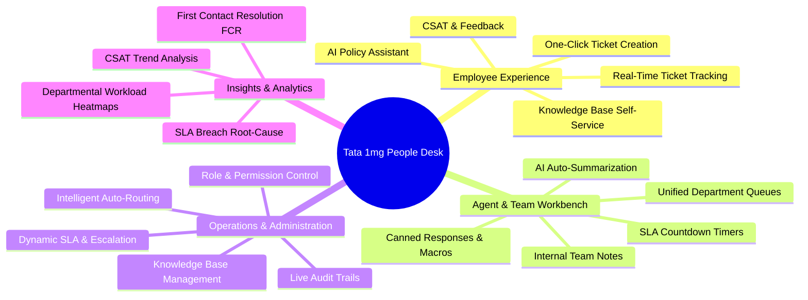

# Core Features & Functional Breakdown
## Project: Tata 1mg People Desk

---

### 1. Feature Map & Module Overview

---

### 2. Detailed Functional Specifications

#### 2.1 AI First-Touch Assistant
- **Purpose**: Resolve employee queries instantaneously without generating overhead for HR and IT support desks.
- **Workflow**:
  1. Employee types natural language query into the search bar.
  2. Gemini RAG engine searches Tata 1mg policy embeddings (`pgvector`).
  3. Formulates a concise answer with relevant document citations.
  4. Prompt offers: *"Did this answer your query?"*
     - If **Yes**: Logs an AI First Contact Resolution (FCR) success event.
     - If **No / Still Need Help**: Automatically pre-fills the ticket creation modal with the query details, category, and priority.

#### 2.2 Smart Ticket Creation & Routing
- **Category & Sentiment Detection**: AI automatically detects whether the query pertains to `HR/Payroll`, `IT Assets`, `Medical Insurance`, `Facilities/Logistics`, or `Workplace Safety`.
- **Priority Scoring**: Mentions of payroll errors, workplace injuries, or laptop hardware failures automatically escalate priority to `P0_CRITICAL` or `P1_HIGH`.
- **File Attachments**: Drag-and-drop support for medical bills, damaged hardware photos, salary slips, and PDF documents with client-side compression and malware screening.

#### 2.3 SLA Countdown & Escalation Engine
- Every ticket computes `sla_due_at` based on its priority matrix:
  - `P0`: 4 hours
  - `P1`: 12 hours
  - `P2`: 24 hours
  - `P3`: 48 hours
- **Warning Trigger**: When 75% of SLA time has elapsed without resolution, an alert badge appears on the Agent Workbench and an email notification is sent.
- **Escalation**: Upon breach, the ticket is marked `is_escalated = true` and re-routed to the Department Lead.

#### 2.4 Agent Workbench & Productivity Tools
- **Split-Pane Layout**: Eliminates tab switching by displaying the ticket queue, active conversation thread, and employee profile simultaneously.
- **Internal Notes**: Support staff can converse privately with other team members or managers without exposing notes to the employee.
- **Canned Responses / Macros**: Standardized snippets for frequent scenarios (e.g., "PF Withdrawal Instructions", "IT Asset Return Policy", "Maternity Leave Checklist").
- **AI Copilot Suggestions**: Automatically suggests 1-click draft responses based on internal policy guides.

#### 2.5 Knowledge Base & Policy Repository
- Searchable directory of official Tata 1mg workplace guidelines.
- Markdown editing and version history for HR admins.
- Thumbs up / down feedback mechanism to continuously measure policy clarity.

#### 2.6 CSAT (Customer Satisfaction) & Quality Loop
- Once a ticket is marked `RESOLVED`, the employee is prompted for a 1-5 star rating and optional comments.
- Low CSAT scores ($< 3$ stars) trigger an automated review ticket for the HR Operations Lead.

