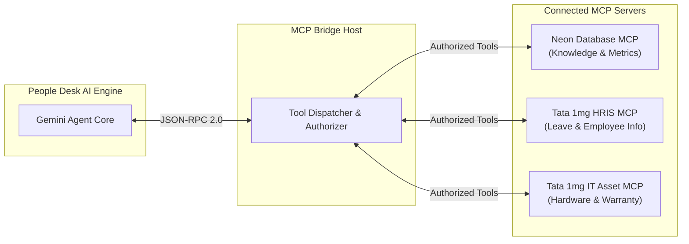

# Model Context Protocol (MCP) Integration
## Project: Tata 1mg People Desk

---

### 1. Architectural Role of MCP

The **Model Context Protocol (MCP)** standardizes how our AI assistants and automated agents securely interface with external systems, databases, and enterprise HR tools at Tata 1mg.

Instead of writing rigid, hardcoded API connectors, the AI Agent interacts with well-defined **MCP Tools and Resources** that provide real-time context (e.g. employee leave balances, IT asset serial numbers, payslip generation status) without compromising access boundaries.



---

### 2. Available MCP Tools

#### 2.1 Neon Database MCP Server (Built-in)
Enables semantic search, analytics querying, and schema inspection directly against the PostgreSQL/Neon database.

- **`run_sql`**: Execute read-only analytical queries (e.g., ticket volume per department, average resolution times).
- **`describe_table_schema`**: Validate table structures and migrations.
- **`inspect_database`**: Monitor connection states and table health.

#### 2.2 Tata 1mg Custom Enterprise MCP Tools

##### Tool: `get_employee_profile`
Retrieves verified identity, reporting line, and organizational metadata.
```json
{
  "name": "get_employee_profile",
  "description": "Fetch verified employee information from Tata 1mg HRMS.",
  "parameters": {
    "type": "object",
    "properties": {
      "empId": { "type": "string", "description": "Tata 1mg Employee ID e.g. '1MG-8492'" }
    },
    "required": ["empId"]
  }
}
```

##### Tool: `get_leave_balance`
Fetches current balance of Privilege Leave (PL), Casual/Sick Leave (CL/SL), and Optional Holidays.
```json
{
  "name": "get_leave_balance",
  "description": "Returns current leave balances for the authenticated employee.",
  "parameters": {
    "type": "object",
    "properties": {
      "empId": { "type": "string" },
      "leaveType": { 
        "type": "string", 
        "enum": ["ALL", "PRIVILEGE", "SICK_CASUAL", "OPTIONAL_HOLIDAY", "MATERNITY", "PATERNITY"] 
      }
    },
    "required": ["empId"]
  }
}
```

##### Tool: `check_it_asset_warranty`
Looks up assigned IT assets (MacBook, Dell laptops, diagnostic tablets, warehouse scanners).
```json
{
  "name": "check_it_asset_warranty",
  "description": "Check device model, serial number, warranty status, and IT support history.",
  "parameters": {
    "type": "object",
    "properties": {
      "empId": { "type": "string" },
      "deviceSerial": { "type": "string" }
    },
    "required": ["empId"]
  }
}
```

##### Tool: `create_ticket_from_context`
Allows the AI assistant to autonomously create a structured ticket with pre-filled context when it cannot directly resolve the issue.
```json
{
  "name": "create_ticket_from_context",
  "description": "Create a support ticket on People Desk on behalf of the employee.",
  "parameters": {
    "type": "object",
    "properties": {
      "empId": { "type": "string" },
      "title": { "type": "string" },
      "description": { "type": "string" },
      "department": { "type": "string", "enum": ["HR", "IT", "PAYROLL", "LOGISTICS", "DIAGNOSTICS"] },
      "priority": { "type": "string", "enum": ["P0_CRITICAL", "P1_HIGH", "P2_MEDIUM", "P3_LOW"] }
    },
    "required": ["empId", "title", "description", "department", "priority"]
  }
}
```

---

### 3. MCP Configuration Blueprint (`mcp_config.json`)

```json
{
  "mcpServers": {
    "neon": {
      "command": "npx",
      "args": ["-y", "@neondatabase/mcp-server"],
      "env": {
        "NEON_API_KEY": "${NEON_API_KEY}"
      }
    },
    "tata1mg-hrms": {
      "command": "node",
      "args": ["./server/mcp/hrms-server.js"],
      "env": {
        "HRMS_API_KEY": "${HRMS_API_KEY}",
        "HRMS_API_ENDPOINT": "https://api.internal.1mg.com/hrms/v1"
      }
    }
  }
}
```

---

### 4. Security & Guardrails
- **Read-Only Enforced by Default**: Tools that query HRMS or database cannot alter payroll or master employee records without explicit secondary multi-factor confirmation.
- **Session Boundary**: The AI assistant can only query tools with the `empId` corresponding to the currently authenticated session user, strictly preventing horizontal privilege escalation.

