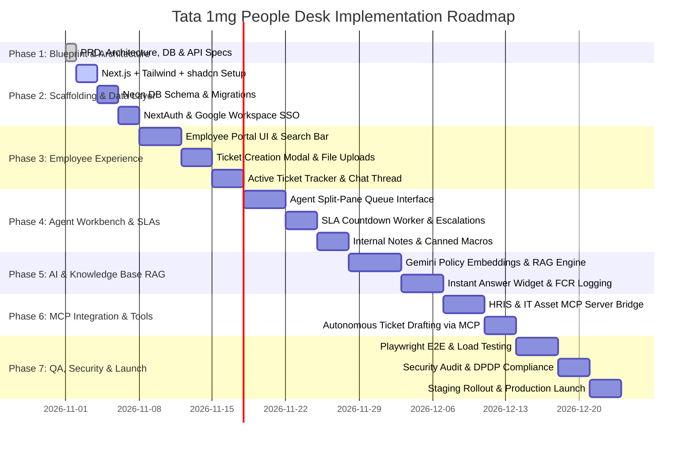

# Project Implementation Plan & Roadmap
## Project: Tata 1mg People Desk

---

### 1. Phased Execution Roadmap

---

### 2. Milestone Deliverables Checklist

#### Phase 1: Planning & Specifications (Completed ✅)
- [x] Product Requirement Document (`docs/PRD.md`)
- [x] Technical Architecture & Data Flow (`docs/ARCHITECTURE.md`)
- [x] UI/UX Wireframes & Brand Guide (`docs/DESIGN.md`)
- [x] Relational Database Schema & ERD (`docs/DATABASE.md`)
- [x] REST API Contract (`docs/API.md`)
- [x] Authentication & Security Guidelines (`docs/AUTH_SECURITY.md`)
- [x] Feature Breakdown & SLA Rules (`docs/FEATURES.md`)
- [x] MCP Protocol & Enterprise Tool Specs (`docs/MCP_CONNECTION.md`)
- [x] Testing Strategy & E2E Scenarios (`docs/TESTING.md`)
- [x] Observability, Health Checks & Runbooks (`docs/DEBUGGING.md`)
- [x] Local Development & Environment Guide (`docs/SETUP.md`)
- [x] Master Roadmap & Milestones (`docs/PLAN.md`)

#### Phase 2: Application Scaffolding (Ready for Execution 🚀)
- [ ] Initialize Next.js 14+ project with TypeScript, ESLint, and Tailwind CSS.
- [ ] Install shadcn/ui components (`button`, `card`, `dialog`, `badge`, `tabs`, `avatar`, `dropdown-menu`, `input`, `textarea`).
- [ ] Set up Prisma ORM with Neon PostgreSQL connection.
- [ ] Seed initial database records (Departments, Categories, Sample Policy Articles, Admin user).

#### Phase 3: Employee Experience MVP
- [ ] Implement Employee Query Home Page with responsive brand navbar.
- [ ] Create search-first query bar with instant autocomplete.
- [ ] Build Ticket Creation dialog with auto-category suggestion and attachment upload.
- [ ] Build Employee "My Tickets" list with live status indicators and real-time thread viewer.

#### Phase 4: Agent Workbench
- [ ] Build Agent Queue view with multi-department filtering.
- [ ] Implement Tri-Pane workbench layout (Queue list, Active conversation, Context pane).
- [ ] Add internal notes (hidden from employees) and canned response macro insertion.
- [ ] Implement SLA calculation logic with warning timers.

#### Phase 5: AI & Knowledge Base RAG
- [ ] Integrate Gemini API for policy document vector embedding.
- [ ] Implement semantic search over HR, IT, and medical insurance policies.
- [ ] Build "Did this solve your query?" feedback flow for AI First Contact Resolution.

#### Phase 6: MCP Integration
- [ ] Configure local MCP bridge for HRIS leave balance lookups.
- [ ] Wire IT asset lookup tool into agent context panel.
- [ ] Enable AI agent to autonomously draft or route tickets via MCP.

#### Phase 7: Testing, Hardening & Launch
- [ ] Implement Vitest unit tests for SLA calculations.
- [ ] Run Playwright end-to-end tests for both employee and agent flows.
- [ ] Perform security review (headers, CSRF, rate-limiting, PII masking).

